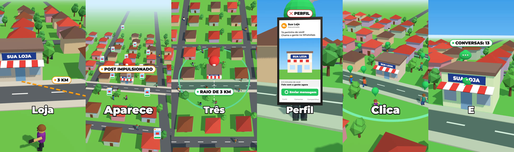

# kit-trafego-ia

Ferramentas abertas para o gestor de tráfego que trabalha com Claude Code ou Codex: subir campanha na
Meta sem nada ligado, checar o criativo contra a política antes de subir, atender no WhatsApp, fazer
vídeo 3D explicativo e montar o canal de YouTube do especialista.



## As ferramentas

| Ferramenta | O que faz | Precisa de |
|---|---|---|
| [subir-campanha-meta](https://github.com/MatheusSBPRO/kit-trafego-ia/tree/main/ferramentas/subir-campanha-meta) | Sobe campanha, conjuntos, criativos e anúncios pela Graph API a partir de um plano em JSON. Tudo nasce pausado. Tem simulação, retomada se cair no meio e conferência do que subiu. | Python 3.9+, token da Meta |
| [checar-criativo-meta](https://github.com/MatheusSBPRO/kit-trafego-ia/tree/main/ferramentas/checar-criativo-meta) | Lê a fala do vídeo, o texto da arte, a copy e a página de destino e marca o que costuma dar reprovação ou bloqueio na Meta: FORA, REVISAR, LIMPO ou PENDENTE. | Python 3.9+ (whisper, opcional, para vídeo) |
| [ia-whatsapp-atendimento](https://github.com/MatheusSBPRO/kit-trafego-ia/tree/main/ferramentas/ia-whatsapp-atendimento) | IA que responde quem chama no WhatsApp do negócio, no seu jeito de falar, e passa para você quando não sabe. Começa em modo sombra: só escreve o que mandaria. | Go, Python 3, Claude Code ou Codex |
| [video-3d-explicativo](https://github.com/MatheusSBPRO/kit-trafego-ia/tree/main/ferramentas/video-3d-explicativo) | Transforma um roteiro em vídeo vertical 3D de 30 a 60 s, com narração por IA, legenda palavra por palavra, câmera que acompanha a fala e efeitos. | Node 18+, Python 3, ffmpeg, chave de voz |
| [youtube-especialista](https://github.com/MatheusSBPRO/kit-trafego-ia/tree/main/ferramentas/youtube-especialista) | Método para montar e operar o canal de YouTube de um especialista: Shorts a partir dos Reels, palavra no comentário, identidade do canal, vídeo longo e leitura. | Claude Code |

Cada pasta tem o próprio README com o passo a passo, os avisos e os limites.

## Início rápido

Requisitos mínimos: `git`, `bash` e Python 3.9+. Cada ferramenta confere o que mais precisa na hora
de instalar.

```bash
git clone https://github.com/MatheusSBPRO/kit-trafego-ia
cd kit-trafego-ia
./instalar.sh --listar                                              # mostra as ferramentas
./instalar.sh --global                                              # instala todas
./instalar.sh --global checar-criativo-meta video-3d-explicativo    # instala só as escolhidas
```

O `--global` copia a skill para `~/.claude/skills` (e para `~/.codex/skills`, se o Codex estiver
instalado), para valer em qualquer pasta. A `ia-whatsapp-atendimento` é um programa que roda no seu
computador: ela é montada dentro da própria pasta, e o próximo passo é o `./bridge.sh` dela.

Depois, no Claude Code ou no Codex, é só pedir:

```
checa esses criativos antes de subir: ~/criativos/lanc01, copy em copy.txt, página https://seusite.com.br
```

```
sobe a campanha de teste: ingresso de R$ 97, 3 criativos da pasta ~/criativos/lanc01, CBO, público aberto
```

## Servidor MCP

O pacote `kit-trafego-ia` coloca as ferramentas de checar criativo e de subir campanha direto no
Claude Code ou no Codex, sem instalar skill. Ele usa só a biblioteca padrão do Python e roda os
mesmos scripts das pastas `ferramentas/`.

| Ferramenta MCP | O que faz | Token |
|---|---|---|
| `checar_criativo` | texto, copy, título, página ou arquivos viram FORA, REVISAR, LIMPO ou PENDENTE, com o trecho e o motivo | não |
| `simular_campanha` | valida o plano e mostra cada chamada que a subida faria, com a verba em centavos. Não acessa a Meta | não |
| `subir_campanha` | cria campanha, conjuntos, criativos e anúncios, tudo PAUSADO. Chamar de novo continua de onde parou | sim |
| `subir_midia` | sobe vídeo ou imagem para a conta e devolve o id ou o hash | sim |
| `conferir_campanha` | lê o que subiu e aponta o que está errado | sim |

### Claude Code

Precisa do [uv](https://docs.astral.sh/uv/) (`uvx`). Só para checar criativo e simular:

```bash
claude mcp add kit-trafego -- uvx kit-trafego-ia
```

Para subir e conferir campanha, passe o token da Meta pela variável `META_TOKEN`:

```bash
claude mcp add kit-trafego -e META_TOKEN=seu-token-aqui -- uvx kit-trafego-ia
```

### Codex

```bash
codex mcp add kit-trafego --env META_TOKEN=seu-token-aqui -- uvx kit-trafego-ia
```

Ou direto no `~/.codex/config.toml`:

```toml
[mcp_servers.kit-trafego]
command = "uvx"
args = ["kit-trafego-ia"]
env = { META_TOKEN = "seu-token-aqui" }
```

Sem o uv: `pip install kit-trafego-ia` e use `kit-trafego-ia` como comando. Para rodar a versão do
GitHub antes de sair no PyPI: `uvx --from git+https://github.com/MatheusSBPRO/kit-trafego-ia kit-trafego-ia`.

### O token e as travas

- **Token só por variável de ambiente.** Nenhuma ferramenta aceita token em argumento, e ele é apagado
  de toda resposta. Use um token de Usuário do Sistema com `ads_management`, `ads_read`,
  `business_management`, `pages_show_list` e `pages_read_engagement`, com o app em modo Live. O token
  fica salvo na configuração do Claude Code ou do Codex no seu computador: não coloque essa
  configuração em repositório.
- **Tudo nasce PAUSADO, sem exceção.** Plano com `ligar_pela_campanha` é recusado, e qualquer escrita
  com status diferente de `PAUSED` é barrada antes de sair. Quem liga é você, no Gerenciador.
- **A simulação não acessa a rede.** Ela roda sem token e não grava nada.
- **Mexe em conta com dinheiro real.** Simule, leia a verba em centavos e confira depois de subir. O
  uso é por sua conta.

O formato do plano está em
[`plano.exemplo.json`](https://github.com/MatheusSBPRO/kit-trafego-ia/blob/main/ferramentas/subir-campanha-meta/skills/subidor-campanha/scripts/plano.exemplo.json)
e as armadilhas da API em
[`armadilhas-meta.md`](https://github.com/MatheusSBPRO/kit-trafego-ia/blob/main/ferramentas/subir-campanha-meta/skills/subidor-campanha/references/armadilhas-meta.md).

## Como contribuir

Toda ajuda conta: um termo novo que deu reprovação no seu nicho, um exemplo de plano, um conserto de
instalação, uma tradução. Leia o [CONTRIBUTING.md](https://github.com/MatheusSBPRO/kit-trafego-ia/blob/main/CONTRIBUTING.md)
e comece por uma das
[issues marcadas como "boa primeira issue"](https://github.com/MatheusSBPRO/kit-trafego-ia/issues?q=is%3Aissue+is%3Aopen+label%3A%22boa+primeira+issue%22).

A regra que não muda: nenhum dado de cliente, ID de conta, token, telefone ou caminho do seu
computador entra no repositório. O CI barra o que achar.

## Estrutura

```
ferramentas/            as 5 ferramentas, cada uma com README, instalador e histórico preservado
src/kit_trafego_ia/     o servidor MCP (só biblioteca padrão)
testes/                 teste do servidor MCP e varredura de dado sensível, usados pelo CI
instalar.sh             instala todas ou só as escolhidas
```

## Licença

MIT. Veja [LICENSE](https://github.com/MatheusSBPRO/kit-trafego-ia/blob/main/LICENSE).

## In English

kit-trafego-ia is an open toolkit for performance marketers who work with Claude Code or Codex. It
bundles five tools: upload Meta ad campaigns from a JSON plan (everything is created paused), check
ad creatives against Meta's advertising policies before upload, run an AI WhatsApp assistant, render
3D explainer videos, and run a YouTube channel for an expert. It also ships an MCP server
(`uvx kit-trafego-ia`, Python standard library only) with `checar_criativo`, `simular_campanha`,
`subir_campanha`, `subir_midia` and `conferir_campanha`. Docs are in Brazilian Portuguese;
contributions in English are welcome, including translations.
